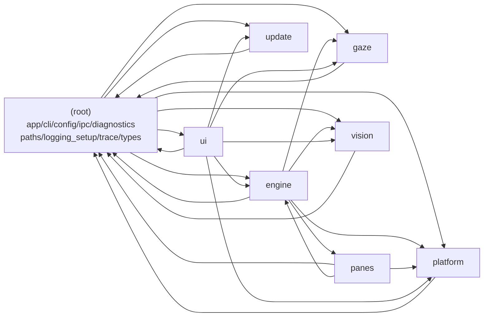

# Harness 工程化改造计划

## 0. 元信息

- 项目 / 仓库：`eye-tracker`（Python 桌面应用，MIT），本地 worktree
  `/Users/kukan/PycharmProjects/eye-tracker/.orca/worktrees/eye-tracker/lionfish`
- 上游远程：`https://github.com/bugraskl/eye-tracker`
- 分支：`harnessing`（从 `likangjie/lionfish` / `main` 同点切出，未动主干）
- 计划版本 / 日期：v1 / 2026-11-06
- 状态：**待确认**（人工确认后才进入阶段 2；确认前不修改任何业务代码）
- 规则来源：`docs/turn-project-to-harness-rules.md`（v1.0，施工期常驻，竣工后按 §14 拆解归档）
- 配套文件：`docs/exec-plans/tech-debt-tracker.md`（问题清单）、`docs/CI.md`（框架判定与 CI 现状）、
  `scripts/analysis/scan_metrics.py`（机械扫描脚本，可重复运行）、
  `docs/exec-plans/active/audits/`（三路审计与机械扫描的原始报告归档）

## 1. 项目概况

### 1.1 技术栈与形态

| 项 | 现状 |
|---|---|
| 语言 | Python `>=3.11,<3.15`；本机 `.python-version` = 3.12 |
| 版本 | `0.3.0`（唯一声明点 `src/eye_tracker/__init__.py:3`，hatchling 动态读取） |
| GUI | PySide6-Essentials（Qt 6 Widgets，无 QML） |
| 视觉 | OpenCV（DNN 跑 MediaPipe FaceLandmarker tflite + YuNet ONNX），`opencv-python-headless` |
| 数值 | numpy；无 scipy / 无 ML 框架 |
| 平台集成 | ctypes（Win32 / COM UIA）、pyobjc（macOS）、python-xlib（Linux X11） |
| 构建 | hatchling + uv（`uv.lock`）；PyInstaller；各平台安装器（Inno Setup / dmg / AppImage） |
| 运行 | `uv run eye-tracker`、`python -m eye_tracker`；CLI 子命令：`run`（默认）、`calibrate`、`doctor`、`bench`、`ctl`、`autostart`、`reset` |
| 部署 | GitHub Actions：tag `v*` → 三平台构建 → GitHub Release（正式发布，非 draft）；网站 GitHub Pages |
| 测试 | pytest（2952 passed / 55 skipped，35.59 s，2026-11-06 本机，macOS） |

### 1.2 顶层模块与入口点

入口点（`pyproject.toml`）：

- `eye-tracker = eye_tracker.cli:main`（console）
- `eye-tracker-gui = eye_tracker.cli:gui_main`（windowed / bundle）
- `python -m eye_tracker` → `eye_tracker.cli.main`（`src/eye_tracker/__main__.py`）

包结构（76 个 Python 文件，39,147 行；职责取自模块 docstring）：

```
src/eye_tracker/
├── __init__.py          版本、APP_* 常量
├── app.py               托盘应用编排：启动顺序、单实例、窗口管理（1317 行）
├── cli.py               命令行入口与子命令（768 行）
├── config.py            类型化设置 + 校验 + 宽容加载（623 行）
├── diagnostics.py       doctor / bench（1319 行）
├── ipc.py               单实例锁 + 本地命令通道（970 行）
├── logging_setup.py     日志配置（245 行）
├── paths.py             文件系统位置（97 行）
├── trace.py             可选跟踪日志（84 行）
├── types.py             共享值类型（270 行，仅依赖 numpy）
├── engine/              决策引擎；除 controller.py 外为纯逻辑（10 个模块）
│   └── controller.py    编排器：相机、模型、决策、OS 动作、热键（3429 行）
├── gaze/                回归模型、One Euro 滤波、校准、持久化、隐式学习（5 个模块）
├── panes/               分屏焦点（实验）：providers、worker、decider（9 个模块）
├── platform/            OS 集成：base、热键、autostart、linux/macos/windows、win_uia（8 个模块）
├── ui/                  Qt 界面：tray、settings、calibration、wizard、overlays 等（12 个模块）
├── update/              可选更新检查与安装（唯一联网代码，6 个模块）
└── vision/              相机、motion gate、face backends、worker 线程（8 个模块 + 模型资产）
```

其他顶层资产：

- `docs/`：8 篇用户/工程文档（architecture、building、calibration、configuration、
  panes、platform-support、privacy、troubleshooting），`configuration.md` 由脚本生成。
- `scripts/`：`check_privacy.py`（隐私门禁，2,203 行）、`fetch_models.py`、`make_icons.py`、
  `gen_config_docs.py`、`smoke_test_bundle.py`、`build_site.py`；本次新增 `analysis/scan_metrics.py`。
- `packaging/`：PyInstaller spec、Windows Inno Setup、macOS dmg、Linux AppImage/AppRun。
- `tests/`：55 个测试文件、37,775 行，按模块与平台分组。

### 1.3 当前测试与 CI 现状（摘要）

- 测试：pytest，2952 passed / 55 skipped / 0 failed（本机 macOS）；Windows 专属用例在本机
  skip（“needs the Win32 API”），macOS UI 用例在非 macOS skip；CI 用三 OS 矩阵补齐。
- CI：5 个 workflow（`ci` / `bundle` / `release` / `build` / `pages`），三方 Action 全部按
  SHA pin，权限最小化；版本 guard 已存在（tag 必须等于 `__version__`）。
- 本地门禁：ruff / mypy（三平台视角）/ 隐私检查 / 模型校验 / 配置文档同步**全部通过**；
  无覆盖率门禁、无本地提交钩子。详见 `docs/CI.md` §2.3。

## 2. 框架判定与 CI 现状

**判定结果：其他类型（非 Tauri）。** 依据（§3.2 机械判定，命中证据）：

- `src-tauri/tauri.conf.json` 不存在
- `src-tauri/Cargo.toml` 不存在
- 根 `package.json` 不存在（无 `@tauri-apps/*` 依赖）
- 实际形态：Python + hatchling + PyInstaller（见 `pyproject.toml`、`packaging/pyinstaller/`）

因此按 §3.4 步骤 F3：不进入 Tauri 三问；现有打包发布流水线**保留并只做审计**；
基础门禁按 §5 阶段 3 增量加强。完整的 workflow 清单、触发条件、发布链路与本地可复现性
对照表见 **`docs/CI.md`**（本计划不重复抄写）。

## 3. 现状诊断

> 所有结论均可由 `scripts/analysis/scan_metrics.py` 复现；问题清单与证据明细见
> `docs/exec-plans/tech-debt-tracker.md`。这里的数字为 2026-11-06 快照。

### 3.1 架构现状

包级依赖（行 → 列表示“import 了”，计数为模块对数，取自机械扫描）：



**分层评估（按现有 import 方向，而非理想模型）**：

| 层 | 模块 | 现状 |
|---|---|---|
| 基座（纯类型/配置） | `types.py`、`config.py`、`paths.py`、`logging_setup.py`、`trace.py` | ✅ 干净：`types` 只依赖 stdlib+numpy；`config` 只依赖 stdlib |
| 纯领域逻辑 | `gaze/*`、`engine/*`（除 `controller.py`） | ✅ 与 `CONTRIBUTING.md` 的声明一致：不 import Qt/OpenCV，时间参数化 |
| 适配器 | `vision/*`、`platform/*`、`update/*`、`ipc.py` | ⚠️ 大体清晰，但 `platform/hotkeys.py` 反向依赖 `cli`（2701 行附近，lazy import 只为取 CLI 文案） |
| 编排器 | `engine/controller.py`、`app.py`、`diagnostics.py` | ⚠️ `controller.py` 同时是领域包成员与 Qt/OS 适配器消费者；`app.py` 与 `cli.py` 互相 import |
| 表示层 | `ui/*` | ⚠️ `ui/settings_dialog.py`、`ui/tray.py` import `cli.cli_command_text`（UI → CLI 反向） |

**循环依赖（模块级强连通分量，机械扫描）**：

1. **18 模块大 SCC**：`app`、`cli`、`diagnostics`、`engine.controller`、`ipc`、
   `platform.hotkeys`、`ui.*`（about/calibration_window/countdown/curtain/icons/overlay/
   preview/settings_dialog/tray/update_dialog/util/wizard）。主要环路：
   - `app → cli` 且 `cli → app`（`cli.py:479/490` lazy import `run_app`）
   - `cli → diagnostics` 且 `diagnostics → cli`（`diagnostics.py:40`）
   - `diagnostics → platform.hotkeys → cli`（`hotkeys.py:2685`）
   - `app → ui.* → cli → app`
2. **2 模块 SCC**：`update.fetch ↔ update.winhttp`（`fetch.py:76` lazy import，
   `winhttp` 反向 import `fetch` 的类型）。

**结论**：这不是“烂架构”，而是一套**工程纪律靠文档与注释维持**的架构——
`CONTRIBUTING.md` 写明了“纯逻辑不得 import Qt/OpenCV”，代码里也确有 lazy import 的
例外注释。缺的是**机械约束**：没有依赖方向检查、没有环检测、没有文件/类大小红线，
因此后续智能体（或人）改动时无法被自动拦截。

### 3.2 复杂度热点

总量：76 个 src 文件 / 39,147 行；2,205 个函数；217 个类；**10 个文件 ≥ 1000 行**。

超长文件（≥600 行，前 10）：

| 文件 | 行数 | 备注 |
|---|---|---|
| `src/eye_tracker/engine/controller.py` | 3429 | `Controller` 一个类 2845 行 / 155 方法 |
| `src/eye_tracker/platform/hotkeys.py` | 2740 | 三平台热键实现同文件（Windows/Carbon/X11） |
| `src/eye_tracker/platform/linux.py` | 2528 | `LinuxPlatform` 945 行 / 53 方法 |
| `src/eye_tracker/ui/settings_dialog.py` | 2029 | `SettingsDialog` 1351 行 / 69 方法 |
| `src/eye_tracker/ui/calibration_window.py` | 1766 | `CalibrationWindow` 849 行 / 52 方法 |
| `src/eye_tracker/vision/backends/facemesh_backend.py` | 1454 | `FaceMeshBackend` 692 行；`process` 77 行/25 决策点 |
| `src/eye_tracker/platform/windows.py` | 1339 | `_Win32` 451 行 / `WindowsPlatform` 479 行 |
| `src/eye_tracker/diagnostics.py` | 1319 | `_problems` 108 行 / **58 决策点**（最高） |
| `src/eye_tracker/app.py` | 1317 | `EyeTrackerApp` 733 行 / 54 方法 |
| `src/eye_tracker/platform/macos.py` | 1230 | `MacPlatform` 760 行 / 47 方法 |

高复杂度函数（决策点，AST 近似 McCabe；≥15 行）：

| 位置 | 函数 | 决策点 | 行数 |
|---|---|---|---|
| `diagnostics.py:814` | `_problems` | 58 | 108 |
| `engine/guard.py:154` | `update` | 30 | 108 |
| `vision/worker.py:409` | `_cycle` | 29 | 111 |
| `panes/decider.py:261` | `update` | 27 | 87 |
| `gaze/model.py:478` | `from_dict` | 27 | 64 |
| `vision/backends/facemesh_backend.py:921` | `process` | 25 | 77 |
| `app.py:195` | `build_app` | 24 | 128 |
| `gaze/calibration.py:537` | `evaluate` | 24 | 112 |
| `vision/backends/face_geometry.py:108` | `parse_face_geometry` | 24 | 43（嵌套 7 层） |
| `engine/decision.py:256` | `update` | 22 | 98 |

**定位**：`controller.py` 与三个平台文件是“业务复杂度不可避免”的重灾区；
`diagnostics._problems`、`guard.update`、`worker._cycle`、`decider.update` 属于
**可拆分但需先有测试护栏**的目标。

### 3.3 重复代码

跨模块近似重复（≥12 行、相似度 ≥0.90）仅 1 对：

- `engine/decision.py:418 _guard` ↔ `panes/decider.py:403 _guard`（21 行，相似度 0.92）

判断：两处是**不同业务规则**（显示器切换 vs 分屏切换）中结构相似的“宽限期/守卫”逻辑，
可以抽公共小工具，也可以保留并在两处注释互指。**不构成大规模复制粘贴债**。
限制：扫描器只比较跨模块函数体（同模块内与更短片段未纳入），结论以“未发现显著重复”为准。

### 3.4 文档缺口

已有优势：README（英/土）、8 篇 `docs/`、CONTRIBUTING、SECURITY、CHANGELOG 共 3,400+ 行，
且 `tests/test_docs.py` 已机械校验：配置文档是否最新（`:26`）、每个配置项是否有说明（`:62`）、
所有 Markdown 相对链接/图片是否存在（`:87`、`:98`）。

缺口（相对 §2 目标态）：

- 无 `AGENTS.md`（入口地图，必需项）
- 无根 `ARCHITECTURE.md`（现有 `docs/architecture.md` 内容好，但：①不是 AGENTS 的默认下一跳；
  ②Code map 未列 `update/`、`paths.py`、`logging_setup.py`、`trace.py`）
- 无 `docs/exec-plans/`（本次新建）、无 `docs/QUALITY_SCORE.md`
- 无 `docs/index.md`、无 `docs/design-docs/`（`core-beliefs.md` 等）
- 无文档新鲜度门禁（架构文档漂移不会被测试发现；只有配置页与链接被校验）
- **已发现 4 组过期内容**（全部漏检）：
  - README / README.tr / `docs/architecture.md:57` 的“零网络”绝对表述与 0.3.0 的 opt-in
    更新检查矛盾（`README.md:37-38` vs `:77-78,139`）
  - `SECURITY.md:12` 支持版本仍写 `0.1.x`（当前 0.3.0）
  - `docs/privacy.md:41` 的 User-Agent 示例写死 `EyeTracker/0.2.1`
  - `docs/building.md` 8 处示例仍用 `0.2.0`（`scripts/smoke_test_bundle.py:9` 还是 0.1.0）
- 无 `prompt-history.txt`（规则 §6.3；当前 `.gitignore` 也未忽略）
- `CONTRIBUTING.md` 的 “Project layout”“Checks” 与未来 `AGENTS.md` 内容重叠，存在双份漂移风险
- 施工期规则文档（1,101 行）被 `tests/test_docs.py` 的 `docs/*.md` glob 当作产品页检查

### 3.5 测试缺口

已有优势：55 个测试文件 / 37,775 行；三 OS 矩阵（3.12 + ubuntu 3.11/3.13）；
隐私门禁本身有“注入违规必须被拦截”的自测（`tests/test_privacy.py` 的
`test_detects_violation` 等）；配置文档页有同步测试。

缺口（`/tmp/harness-scan/quality-audit.md` 的 29 条已并入台账）：

- **无覆盖率测量/门禁**：`pyproject.toml` 的 dev 依赖只有 pytest/ruff/mypy（无 pytest-cov 或
  coverage 配置），`ci.yml` 无覆盖率步骤；无法回答“关键路径覆盖了多少”
- **网络传输层零行为测试**：`update/winhttp.py`（175 行，唯一网络代码）没有任何测试 import；
  测试只用 FakeTransport，隐私测试只按文本匹配 allowlist
- **无结构测试**：依赖方向、禁止 import、文件/函数大小、循环依赖均无测试
- **无性能回归门禁**：README 的 CPU 声明由人工 `eye-tracker bench` 验证，CI 不设阈值
- **测试质量**：3 个用例零断言、9 个仅弱断言；8 个测试依赖 `time.sleep`/墙钟紧上界，
  且无 pytest-timeout
- **UI 覆盖密度最低**：UI 包 25.2 用例/千行，其他包 74–133；`FakeController` 与真实
  `Controller` 无契约测试（接口漂移不会被发现）
- 平台专属用例在本机 skip 55 个（Windows 33 / 人脸照片 10 / Linux 7 / macOS 4 / Inno 1）；
  人脸精度声明的 10 个用例在 CI 也永远 skip（未设 `EYE_TRACKER_TEST_FACE`）
- 无测试坏味道扫描（重复 setup、过度 mock、弱断言）的机械检查

### 3.6 安全、隐私与可靠性（阶段 1 已核实部分）

已有优势：

- **隐私门禁** `scripts/check_privacy.py`（2,203 行）：AST 扫源码 + 扫 bundle 原生库/压缩包，
  白名单只有 `update/winhttp.py` 的 opt-in 更新检查；错误信息写明修复方式
- **更新链路**：`update/fetch.py:26` 固定 `ALLOWED_HOSTS`；`installer.py:124` 用
  `hmac.compare_digest` 校验 SHA-256；`subprocess.Popen` 无 shell；隐私文档记录信任边界
- 全仓无 `shell=True`、无 `os.system`、无 `eval/exec`、无 `pickle`/`yaml.load`
  （机械扫描确认；7 个 “exec(” 均为 Qt `loop.exec()` 的误报）
- 线程：vision worker `stop(timeout=3.0)` + join；IPC 有 DEFAULT/PROBE/IDLE 超时；
  hotkey 回调用 `SimpleQueue`

**审计发现的最高风险（P1，详见台账 TD-SEC-001）**：自更新下载的安装器**没有** Authenticode/
Sigstore 校验，仅比对同一 release 里的 `SHA256SUMS.txt`，随后 `/VERYSILENT` 静默执行——
能替换 GitHub release 两个资产（或注入受信 TLS 链路）者即可获得当前用户权限执行。
文档已如实披露该边界；修复需要签名基建（见 D14）。

其余待补（P2，详见台账 SEC/PERF/CI 节）：

- IPC 身份校验在“无法判定”时 fail-open；Linux 私有目录不可用时回退共享 `/tmp` 固定名 socket
- 日志与 `--trace` 文件默认 0644（settings/calibration 为 0600），多用户 Linux 上可能被同机读
- doctor 报告只脱敏 home，非 home 绝对路径可能进入公开 bug 报告
- 更新下载无总 deadline/min-rate；校验→执行之间有 TOCTOU 窗口；WinHTTP 设置返回值未检查
- 摄像头 `read()` 无 OpenCV 层超时，阻塞读会延迟隐私/暂停时的设备释放
- GUI 线程上执行可能阻塞的 D-Bus / AX / 进程枚举轮询（最坏单 tick 0.5–1 s）
- Windows 用 `ASFW_ANY` 放宽前台权限；Windows 无代码签名、macOS 未 notarize、
  macOS 稳定签名证书是可选 secret
- **待复核**：FFmpeg 本地容器/播放列表可能引用远程 URL（若成立，是“never sends a byte”
  承诺的实质缺口，实验方案见 D15）
- 隐私门禁的覆盖边界与其“任何网络 import/call”文案不符；`pages.yml` 用
  `pip install "pillow>=10.4"` 绕过 uv.lock；release job 同时持有四种写权限

### 3.7 门禁现状

| 门禁 | 现状 |
|---|---|
| ruff lint / format | ✅ CI + 本地，全绿 |
| mypy（默认/win32/darwin/scripts&packaging） | ✅ CI + 本地，全绿 |
| pytest | ✅ CI 三 OS 矩阵；本地 2952 passed |
| 隐私 gate / 模型校验 / 配置文档同步 / 链接检查 | ✅ CI + 本地 |
| shellcheck / desktop-file-validate | ✅ CI（本地需自行安装工具，CONTRIBUTING 未给命令） |
| 覆盖率 | ❌ 无 |
| 结构/依赖方向检查 | ❌ 无 |
| 本地提交钩子 | ❌ 无（PR 模板是人工 checklist） |
| YAML / Actions 静态检查 | ❌ 无 actionlint |
| 版本 guard | ✅ `build.yml` prepare 已校验 tag == `__version__` |
| 发布门禁依赖测试 | ❌ tag push 只触发 release.yml，ci.yml 不监听 tag，构建/发布链路不跑 pytest |
| 发布方式 | ⚠️ tag 直接正式发布（非 draft），无 environment 审批；dispatch 到 tag ref 也会发布 |
| 依赖漏洞 / secret / CodeQL | ❌ 无 |
| workflow 静态检查（actionlint） | ❌ 无（只有正则切 YAML 的文本断言） |
| 文档新鲜度（架构/README） | ❌ 无（只有配置页与链接） |

### 3.8 改造定位（重要）

这个仓库**不是“缺纪律的存量项目”**：CI、隐私门禁、类型检查、跨平台测试、发布 guard、
文档同步都已相当成熟。harness 改造的收益点不是“补基础”，而是：

1. **把已有的隐性纪律变成机械约束**（依赖方向、大小红线、文档新鲜度）；
2. **补齐 Agent-First 的知识入口**（AGENTS.md / ARCHITECTURE.md / index / core-beliefs /
   exec-plans / QUALITY_SCORE），让智能体不靠通读 39k 行源码才能安全改动；
3. **给最重、改动最频繁的区域加护栏后再拆分**（controller、platform、UI 大文件），
   而不是为了“好看”大爆炸重构；
4. **补上发布链路的测试门禁**（tag 发布目前不依赖 pytest），这是 CI 审计唯一的 P1。

## 4. 改造批次划分

批次按业务域拆分，B0 先建文档与门禁（阶段 2–3），B1 起才动业务代码（阶段 4）。
每批独立分支、独立提交、独立回滚；不改变业务行为（红线 R1/R2）。

| 批次 | 覆盖业务域 | 主要目标 | 依赖前置 | 回滚方案 |
|---|---|---|---|---|
| **B0** | 仓库知识布局 + 门禁 | AGENTS.md、ARCHITECTURE.md、docs 结构、QUALITY_SCORE、本地门禁脚本、覆盖率/结构检查脚手架 | 阶段 1 计划获确认 | 纯文档/工具提交，`git revert` 即可；无运行时影响 |
| **B1** | 编排核心：`engine/controller.py`、`app.py`、`ipc.py`、`cli.py` | 先补特征测试，再按职责抽取协作对象（相机生命周期、热键、窗口管理、CLI 文案下沉），消除 `app↔cli` 环 | B0 门禁可用；controller 覆盖率基线建立 | 每步单独 commit，`git revert` 回滚；行为由特征测试锁定 |
| **B2** | 平台层：`platform/*`（hotkeys/linux/windows/macos/autostart/win_uia） | 按 OS/后端拆分 hotkeys；平台差异测试补齐；错误路径覆盖 | B0 + B1 的接口稳定 | 逐文件拆分提交；平台行为用现有测试 + 手工冒烟核对 |
| **B3** | 界面层：`ui/*`（settings_dialog/calibration_window/tray/wizard/util） | 对话框按页签/职责拆分；UI 与 controller 接口显式化；消除 UI→cli 反向依赖 | B1 的 controller 接口稳定 | 每步 `git revert`；UI 行为用 `QT_QPA_PLATFORM=offscreen` 测试 |
| **B4** | 视觉管线：`vision/*`（facemesh_backend/camera/worker/motion） | `process`/`_cycle` 拆段；模型加载与帧循环职责分离；保持 CPU/延迟指标 | B0 的性能基线（bench 前后各测） | 逐提交回滚；用 `eye-tracker bench` + `tests/test_*` 对比 |
| **B5** | 注视与校准：`gaze/*`（model/store/calibration/learning/filters） | `from_dict`/`evaluate` 拆段；模型兼容性测试补齐；数据结构显式化 | B0；合成数据夹具 | 逐提交回滚；旧校准文件回归测试（`tests/test_store.py`） |
| **B6** | 分屏焦点（实验）：`panes/*` | 与 `engine/decision` 的守卫逻辑去重或互指；provider 错误路径测试 | B1（controller 接口） | 功能默认关闭，回滚无用户影响 |
| **B7** | 更新与发布链路：`update/*`、`scripts/`、`packaging/`、`.github/` | 更新器信任边界测试与签名校验（TD-SEC-001）；**发布前强制测试门禁**（TD-CI-001）；打包脚本门禁化；CI 增量（覆盖率/actionlint），**不重建发布流水线** | B0 门禁；`docs/CI.md` 先对齐；D11/D14 决策 | 只增量改 workflow；`git revert` + 重跑 CI 验证 |

**优先级依据**（§1.4 原则 3：改动频率 × 故障代价）：`controller.py`、`hotkeys.py`、
`linux.py`、`settings_dialog.py`、`facemesh_backend.py` 同时具备“最高行数 + 最高历史改动量”
（git numstat 前五），故 B1/B2/B3/B4 最先加护栏。

## 5. 五阶段任务拆解

> 角色：**L** = 主智能体（Lead）；**A** = 子审计智能体（可并行、只读）；**R** = 独立复核智能体
> （对产出做对抗式检查）；**H** = 人类（确认计划 / 回答决策 / 验收）。
> 每条验收标准都必须是可机械检查的（命令、断言或文件检查），不接受“看起来对”。

### 阶段 1 · 全量扫描与问题清单（本次，已完成草稿，待 H 确认）

| ID | 子任务 | 角色 | 产出物 | 机械验收标准 |
|---|---|---|---|---|
| P1-1 | 建立仓库地图（模块/入口/构建/运行/部署） | L | 本计划 §1 | §1.2 列出的包数 = `scan_metrics.py --json` 的模块父包集合（10 个）+ 9 个根模块；入口点数 = `pyproject.toml` 的 `[project.scripts]` + `[project.gui-scripts]` 条目数 |
| P1-2 | 框架识别（§3.2） | L | `docs/CI.md` §1 | `docs/CI.md` 含三条判定证据路径；三条路径在本仓库均不存在（`test ! -e`） |
| P1-3 | 架构现状（依赖图/环） | L | 本计划 §3.1 | 图与 `scan_metrics.py` 的 `package_edges`、`cycles` 输出一致；每条环给出至少一个 `file:line` |
| P1-4 | 复杂度度量 | L | 本计划 §3.2 + 台账 CPLX 条目 | 阈值（≥600 行文件、≥60 行函数、≥300 行类）全部来自脚本输出；每条含 `file:line` |
| P1-5 | 重复代码识别 | L | 本计划 §3.3 + 台账 DUP 条目 | 复用 `scan_metrics.py` 的 duplicates 段；阈值与限制写在正文 |
| P1-6 | 文档缺口盘点 | A（quality）+ L | 本计划 §3.4 + 台账 DOC 条目 | 每条缺口用 `[ -e path ]` 或 `file:line` 证明 |
| P1-7 | 测试缺口盘点 | A（quality）+ L | 本计划 §3.5 + 台账 TEST 条目 | 给出 pytest 计数 + 覆盖映射；每条含测试文件或模块路径 |
| P1-8 | 安全审计 | A（risk）+ L | 台账 SEC 条目 | 每条含 `file:line`；网络调用点与 `check_privacy.py` 白名单对齐 |
| P1-9 | 性能与可靠性审计 | A（risk）+ L | 台账 PERF 条目 | 每条含 `file:line` + 具体机制（超时/队列/线程/循环） |
| P1-10 | 提交门禁现状审计 | A（ci）+ L | `docs/CI.md` §2.3 + 台账 CI 条目 | CI 每个 step 都能映射到本地命令或标记“不可本地复现”；缺口逐条登记 |
| P1-11 | 风险分级与排序 | L + R | 台账严重度列 + 本计划 §4 | 每条问题恰有一个 P0/P1/P2；P0 数量与“阻塞后续改造”定义一致 |
| P1-12 | 分域批次与回滚 | L + H | 本计划 §4 | 每批都有回滚方案；批次覆盖全部台账条目（无孤儿条目） |
| P1-13 | 未改业务代码自证 | L | git 记录 | `git diff --stat main -- src tests packaging .github` 为空；`git status` 只含文档/脚本 |

**阶段 1 完成定义**：本计划 + `tech-debt-tracker.md` + `docs/CI.md` + 扫描脚本已入库；
`git diff --stat` 证明未改业务代码；H 明确回复“确认计划”。

### 阶段 2 · 文档对齐（H 确认后执行）

| ID | 子任务 | 角色 | 产出物 | 机械验收标准 |
|---|---|---|---|---|
| P2-1 | 新建 `AGENTS.md`（地图非百科） | L | `AGENTS.md` | ≤200 行（目标 ~100）；必含 §2.2 的 5 节；其中每条链接目标存在；`tests/test_docs.py` 的链接检查覆盖它 |
| P2-2 | 编写根 `ARCHITECTURE.md` | L + R | `ARCHITECTURE.md` | 覆盖全部包（含 `update/`、`paths.py`、`logging_setup.py`、`trace.py`）；写出依赖方向规则；与 `scan_metrics` 的包边一致 |
| P2-3 | 建立 `docs/` 结构 | L | `docs/index.md`、`docs/design-docs/index.md`、`docs/design-docs/core-beliefs.md`、`docs/QUALITY_SCORE.md`、`docs/exec-plans/` | `docs/index.md` 索引到的每个文件都存在；`docs/exec-plans/{active,completed}` 存在；`QUALITY_SCORE.md` 覆盖 8 个业务域 |
| P2-4 | 沉淀 `core-beliefs.md` | L + H | `docs/design-docs/core-beliefs.md` | 每条原则能指向一个代码/测试证据；与 CONTRIBUTING 的 Ground rules 不矛盾（人工复核） |
| P2-5 | 清理过时内容 / 标注待核实 | L | 修订后的 `docs/*.md` | 修正 `docs/architecture.md` Code map 缺项；无法判断的内容标 `待核实` 并登记台账，不静默删除 |
| P2-6 | 把隐性知识搬进仓库 | L | `docs/design-docs/*.md`（至少：线程模型、单实例 IPC、隐私边界、发布链路） | 每篇含代码路径引用；发布链路文与 `docs/CI.md` 不冲突 |
| P2-7 | 建立 `QUALITY_SCORE.md` | L | `docs/QUALITY_SCORE.md` | 每域有分值与证据（覆盖率/复杂度/文档）；与台账 ID 关联 |
| P2-8 | 迁移计划与台账到标准位置 | L | `docs/exec-plans/active/*` | 本阶段后阶段 1 文件位置不变（已在标准位置）；`completed/` 目录空但存在 |
| P2-9 | 补全工程化说明 | L | `docs/building.md`、`docs/troubleshooting.md`、`docs/privacy.md` 更新 | 本地开发/构建/测试/调试/发布/排障各有可复制命令；CI 的每个 step 都有对应说明或“仅 CI”标注 |
| P2-10 | 建立文档防腐 | L | 扩展 `tests/test_docs.py` + doc-gardening 说明 | 新增测试：AGENTS ≤200 行、docs/index 完整、ARCHITECTURE 必含节；对注入的漂移样例必须失败（实测） |

**阶段 2 验收**：`pytest tests/test_docs.py` 通过；文档与代码现状一致（抽样命令）；
`AGENTS.md` 能从仓库根找到所有深层文档；H 验收。

### 阶段 3 · 门禁审计与自动化质量校验

| ID | 子任务 | 角色 | 产出物 | 机械验收标准 |
|---|---|---|---|---|
| P3-1 | 门禁清单 | L | `docs/CI.md` §4 | 每个 CI step ↔ 本地命令 ↔ 是否 blocking，三列完整 |
| P3-2 | 统一本地门禁入口 | L | `scripts/check.py`（或等价） | 一条命令跑完 ruff/mypy/pytest/隐私/模型/配置文档；退出码与 CI 一致 |
| P3-3 | 本地提交钩子（待 D2 决策） | L | `.pre-commit-config.yaml` 或 git hook 脚本 | 故意提交一个 lint 违规文件时钩子失败（实测并记录） |
| P3-4 | 自定义 linter：文件/函数大小上限（T1） | L | `scripts/lint_size.py` + 基线豁免清单 | 报错信息含修复指令；对超限样例必须失败；现有存量按基线豁免且数量只降不升 |
| P3-5 | 自定义结构测试：依赖方向（T7） | L | `tests/test_architecture.py` | 违反白名单的 import 样例必须失败；当前代码在“豁免清单”下方可通过 |
| P3-6 | 文档 lint 加强（T9） | L | `tests/test_docs.py` 扩展 | 缺必填节/索引漏项/AGENTS 超长三类漂移必须失败 |
| P3-7 | CI 增量接入 | L | `.github/workflows/ci.yml` 修订 | 只增量、不改发布流水线；新 job 在 PR 上跑；故意破坏样例使 CI 红（实测） |
| P3-8 | 门禁自证（DoD 4） | R | `docs/CI.md` §4 + 测试 | 每条新不变量都有一个“注入违规 → 必须失败”的测试；结果记录在案 |

**阶段 3 验收**：任一新提交都被自动校验；所有新门禁可本地复现；门禁实测能拦截。

### 阶段 4 · 问题修复与重构（按 B1→B7 串行）

| ID | 子任务 | 角色 | 产出物 | 机械验收标准 |
|---|---|---|---|---|
| P4-0 | 指标基线快照 | L | `docs/exec-plans/active/metrics-baseline.json` | `scan_metrics.py --json` 输出入库；后续每批对比 |
| P4-B1 | 编排核心（controller/app/ipc/cli） | L | 分步重构提交 + 更新文档 | 每步：`pytest` 全绿；`scan_metrics` 中 controller 行数下降或职责文件新增；无新 SCC；行为无变化（特征测试锁定） |
| P4-B2 | 平台层（platform/*） | L | 拆分后的模块 + 平台测试 | 三平台 CI 全绿；本机 skip 数不增加；hotkeys 按后端拆分后行为不变（现有 test_hotkeys 全绿） |
| P4-B3 | 界面层（ui/*） | L | 拆分后的对话框/组件 | offscreen UI 测试全绿；UI 不再 import `cli`（结构测试断言） |
| P4-B4 | 视觉管线（vision/*） | L | 拆分后的 backend/worker | `bench` 前后指标不退化（记录数值）；VisionWorker 生命周期测试全绿 |
| P4-B5 | 注视与校准（gaze/*） | L | 拆分后的 model/store 逻辑 | 旧校准文件兼容测试全绿；`from_dict` 决策点下降 |
| P4-B6 | 分屏焦点（panes/*） | L | 去重/互指 + 测试 | 守卫逻辑二选一（抽公共或文档互指）；panes 测试全绿 |
| P4-B7 | 更新与发布链路（update/scripts/packaging/.github） | L | 增量 CI + 测试 | 发布流水线结构不变；更新器信任边界测试全绿；`docs/CI.md` 变更历史更新 |
| P4-9 | 每批回滚演练 | L + H | 进度日志 | 每批至少一次 `git revert` 演练或在分支上验证可回滚；记录 commit 范围 |

**阶段 4 验收**：每批提交均通过门禁；行为守恒有证据（测试 + 指标）；复杂度/重复度下降；
进度日志逐条对应 commit。

### 阶段 5 · 测试补全与门禁接入

| ID | 子任务 | 角色 | 产出物 | 机械验收标准 |
|---|---|---|---|---|
| P5-1 | 覆盖率基线 | L | `pyproject.toml` 覆盖率配置 + 首次报告 | `pytest --cov=eye_tracker` 可运行；基线数值记录 |
| P5-2 | 覆盖率门禁（阈值待 D1） | L | CI 覆盖率步骤 | 低于阈值时 CI 失败（实测注入）；阈值不低于基线 |
| P5-3 | 按 QUALITY_SCORE 补测试 | L | 新增/加强测试文件 | 每个 ≤3 分域都有对应补测；关键路径（切换/校准/更新/隐私）有回归测试 |
| P5-4 | 结构测试接入 CI | L | `tests/test_architecture.py`、`test_docs.py`、size lint | 三者在 CI 中 blocking；本地一条命令可跑 |
| P5-5 | 性能冒烟（可选，待 D7） | L | bench 脚本 + 阈值 | `eye-tracker bench` 的 CPU/延迟阈值在 CI 或 nightly 可执行；连续两次运行稳定 |
| P5-6 | 完成定义自检（§11.1） | L + R + H | `docs/QUALITY_SCORE.md` 更新 + 验收记录 | §11.1 的 10 条逐条勾选并附证据路径 |

**阶段 5 验收**：覆盖率达标；结构性规则被自动拦截；§11.1 完成定义全部满足。
通过后按 §14 执行“收官拆解”（单独提交，需 H 确认）。

## 6. 待人工决策清单

| 编号 | 问题 | 为什么需要人判断 | 影响范围 |
|---|---|---|---|
| D1 | 覆盖率工具与阈值：采用 pytest-cov？阈值定多少（建议先测基线，再定“不低于基线”的整数阈值） | 覆盖率目标与团队成本取舍，不可从代码推断 | 阶段 5 门禁 |
| D2 | 是否引入 pre-commit 本地钩子（还是只保留 CI + 文档 checklist） | 改变开发者本地工作流；有人可能反感自动改文件 | 阶段 3 / B0 |
| D3 | `ARCHITECTURE.md` 放置：把 `docs/architecture.md` 迁到根并保留跳转，还是根文件只做摘要+链接 | 影响外部链接与 README 引用方式 | 阶段 2 |
| D4 | `controller.py` 拆分范围：目标“可维护的编排器”还是“彻底分层”（后者风险与工期显著更高） | 业务风险与收益取舍 | B1 / 阶段 4 |
| D5 | 新增文档语言：仓库现有文档为英文；AGENTS/ARCHITECTURE/core-beliefs 用英文、中文还是双语 | 读者与智能体使用习惯 | 阶段 2 |
| D6 | 是否启用 `prompt-history.txt`（规则 §6.3 要求，但它是本地非版本化文件） | 涉及个人提示词留存与 .gitignore 变更 | 阶段 2 / 全程 |
| D7 | 是否引入性能回归门禁（nightly bench 阈值）；CPU 声明是否需要在 CI 机械验证 | 环境噪声导致 flaky 的风险 vs 声明可信度 | 阶段 5 |
| D8 | 是否为 Intel macOS / Linux arm64 增加构建目标（当前发布仅 arm64 Mac 与 x86_64 Linux，文档已声明） | 产品与 CI 成本决策，不可从代码推断 | B7 / CI |
| D9 | 是否把 `docs/configuration.md` 迁入 `docs/generated/`（当前为公开文档路径，生成标记已存在） | 影响 README/用户链接 | 阶段 2 |
| D10 | 门禁基线的处理：存量超大文件/类是否“冻结存量、只卡新增”（推荐），还是要求阶段 4 一次性降到阈值内 | 决定阶段 4 的工期与风险 | 阶段 3 / 4 |
| D11 | 发布门禁与发布方式：①release 前是否强制跑测试矩阵；②继续“tag 直接正式发布”还是改 draft / protected environment；③是否校验 tag 必须指向 main 祖先 | 产品发布流程决策；会改变现有发布行为 | B7 / 阶段 3 |
| D12 | GitHub Settings 侧确认：`ci.yml`/`bundle.yml` 是否为合并前 required checks、tag 是否受保护、macOS 签名 secrets 是否已配置 | 仓库文件里不可见，影响 TD-CI-001/003/006 的真实风险 | 阶段 1 确认 / B7 |
| D13 | CI 成本策略：docs-only PR 是否跳过全矩阵；`src/**` PR 是否继续跑三平台 60 min bundle，还是改为 label/nightly 触发 | 成本与覆盖的取舍 | B7 |
| D14 | 更新器签名方案（对应唯一 P1 安全项）：Windows Authenticode（WinVerifyTrust）还是内置 Sigstore 公钥/独立签名校验清单？需要密钥管理与发布流程配合 | 安全加固需要签名基建与密钥托管，属产品/运维决策 | B7 / 阶段 3 |
| D15 | FFmpeg 本地容器是否可能引用远程 URL：是否做隔离网络 `strace -f -e connect` 实验；若成立，是否限制可接受的容器/播放列表格式 | 影响“never sends a byte”承诺的边界与隐私文档措辞 | 阶段 1 复核 / B4 |
| D16 | 隐私门禁范围与文案：是否把 `eval/exec`、`QDesktopServices.openUrl`、运行时拼接的 `getattr/__import__` 纳入规则；是否扫描会进 bundle 的 `scripts/`/`packaging/` 代码；文案改成“静态扫描 + bundle 扫描” | 门禁严格度与误报成本取舍 | 阶段 3 |
| D17 | 依赖 CVE 与主版本策略：离线无法判定 OpenCV 5 / numpy 2.5 / Qt 6.11 的已知漏洞；是否给生产依赖加上界、是否把 `hatchling` 纳入锁定 | 升级灵活性与供应链安全的取舍 | B7 |

## 7. 进度与决策日志

| 日期 | 阶段 | 动作 | 关联 commit | 决策与理由 |
|---|---|---|---|---|
| 2026-11-06 | 阶段 1 | 切 `harnessing` 分支；仓库扫描；建立本计划、台账、`docs/CI.md`、`scripts/analysis/scan_metrics.py` | 待填 | 框架判定=其他（非 Tauri），不进入三问；现有门禁全绿，改造聚焦 Agent-First 知识布局与机械约束 |
| 2026-11-06 | 阶段 1 | 并行只读审计：CI/构建发布、测试与文档、安全与性能 | — | 子智能体只读，产出写入 `/tmp/harness-scan/`，由 L 汇总入台账；原始报告归档到 `docs/exec-plans/active/audits/` |
| 2026-11-06 | 阶段 1 | 审计结论：CI 51 条（P1=发布不依赖测试）、测试/文档 29 条（P1=覆盖率/winhttp/文档门禁/零网络矛盾）、安全/可靠性 17 条（P1=更新器无签名校验） | — | 三份原始报告归档到 `docs/exec-plans/active/audits/`；按根因归并为台账 105 条（P0=0 / P1=21 / P2=84） |
| 2026-11-06 | 阶段 1 | 决策项扩到 D17（发布门禁、GitHub Settings、CI 成本、更新器签名、FFmpeg 复核、隐私门禁范围、依赖 CVE） | — | 等 H 在确认计划时一并回答；未回答前阶段 3 不落 CI 变更 |
| 2026-11-06 | 阶段 1 | 提交阶段 1 产出（不含业务代码） | 待填 | 计划状态=待确认；等 H 确认后再进入阶段 2 |
